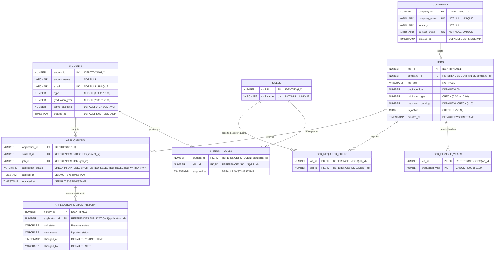

# Entity-Relationship (ER) Diagram & Data Architecture

## 1. Architectural Overview

The **Smart Campus Placement and Eligibility Automation System** is architected as a normalized, relational database in **Oracle Database 19c/21c/23c**. All business rules, eligibility validations, audit logs, and status transitions reside in the database layer via **PL/SQL packages, database triggers, views, and declarative constraints**.

---

## 2. Mermaid Entity-Relationship (ER) Diagram

---

## 3. Relational Table Dictionary

### 3.1. `STUDENTS`
- **Purpose**: Stores student academic profiles, academic credentials, and backlog status.
- **Primary Key**: `student_id` (Auto-generated identity starting at 1001).
- **Constraints**:
  - `uq_students_email`: Unique constraint on `email`.
  - `chk_students_cgpa`: `cgpa BETWEEN 0.00 AND 10.00`.
  - `chk_students_backlogs`: `active_backlogs >= 0`.
  - `chk_students_grad_year`: `graduation_year BETWEEN 2000 AND 2100`.

### 3.2. `SKILLS`
- **Purpose**: Master repository of normalized technical skills (e.g., Python, Java, Oracle SQL, PL/SQL).
- **Primary Key**: `skill_id` (Auto-generated identity starting at 1).
- **Constraints**:
  - `uq_skills_name`: Case-sensitive unique constraint on `skill_name`.

### 3.3. `STUDENT_SKILLS`
- **Purpose**: Pure intersection table establishing a Many-to-Many ($M:N$) relationship between `STUDENTS` and `SKILLS`.
- **Primary Key**: Composite (`student_id`, `skill_id`).
- **Foreign Keys**:
  - `student_id` $\rightarrow$ `STUDENTS(student_id)` `ON DELETE CASCADE`.
  - `skill_id` $\rightarrow$ `SKILLS(skill_id)` `ON DELETE CASCADE`.

### 3.4. `COMPANIES`
- **Purpose**: Registered corporate employers and recruiting organizations.
- **Primary Key**: `company_id` (Auto-generated identity starting at 501).
- **Constraints**:
  - Unique constraints on `company_name` and `contact_email`.

### 3.5. `JOBS`
- **Purpose**: Job profiles / recruitment drives posted by companies.
- **Primary Key**: `job_id` (Auto-generated identity starting at 201).
- **Foreign Key**: `company_id` $\rightarrow$ `COMPANIES(company_id)` `ON DELETE CASCADE`.
- **Constraints**:
  - `chk_jobs_min_cgpa`: Minimum CGPA cutoff between 0.00 and 10.00.
  - `chk_jobs_max_backlogs`: Maximum allowed backlogs $\ge 0$.
  - `chk_jobs_is_active`: Flag restricted to `'Y'` or `'N'`.

### 3.6. `JOB_ELIGIBLE_YEARS`
- **Purpose**: Resolves the multi-valued attribute of eligible passing-out batches into Third Normal Form ($3\text{NF}$). A single job may invite multiple batches (e.g., 2024 and 2025).
- **Primary Key**: Composite (`job_id`, `graduation_year`).
- **Foreign Key**: `job_id` $\rightarrow$ `JOBS(job_id)` `ON DELETE CASCADE`.

### 3.7. `JOB_REQUIRED_SKILLS`
- **Purpose**: Establishes a Many-to-Many ($M:N$) relationship between `JOBS` and prerequisite `SKILLS`.
- **Primary Key**: Composite (`job_id`, `skill_id`).
- **Foreign Keys**:
  - `job_id` $\rightarrow$ `JOBS(job_id)` `ON DELETE CASCADE`.
  - `skill_id` $\rightarrow$ `SKILLS(skill_id)` `ON DELETE CASCADE`.

### 3.8. `APPLICATIONS`
- **Purpose**: Tracks student applications for specific placement opportunities.
- **Primary Key**: `application_id` (Auto-generated identity starting at 8001).
- **Foreign Keys**:
  - `student_id` $\rightarrow$ `STUDENTS(student_id)` `ON DELETE CASCADE`.
  - `job_id` $\rightarrow$ `JOBS(job_id)` `ON DELETE CASCADE`.
- **Unique Constraint**:
  - `uq_student_job_app`: Unique composite (`student_id`, `job_id`) preventing duplicate applications at the database engine level.
- **Status Check Constraint**:
  - `application_status IN ('APPLIED', 'SHORTLISTED', 'SELECTED', 'REJECTED', 'WITHDRAWN')`.

### 3.9. `APPLICATION_STATUS_HISTORY`
- **Purpose**: Immutable audit log table populated exclusively by the `trg_app_status_audit` trigger to track every lifecycle status change with timestamps and user details.
- **Primary Key**: `history_id` (Auto-generated identity starting at 1).
- **Foreign Key**: `application_id` $\rightarrow$ `APPLICATIONS(application_id)` `ON DELETE CASCADE`.

---

## 4. Normalization Analysis

1. **First Normal Form (1NF)**:
   - All attributes contain atomic values.
   - Repeating groups (such as multiple skills per student or multiple eligible batches per job) are decoupled into discrete junction tables (`STUDENT_SKILLS`, `JOB_REQUIRED_SKILLS`, `JOB_ELIGIBLE_YEARS`) rather than comma-separated strings.
2. **Second Normal Form (2NF)**:
   - The schema is in 1NF.
   - All non-key attributes are fully functionally dependent on the complete primary key (no partial dependencies on composite keys).
3. **Third Normal Form (3NF)**:
   - The schema is in 2NF.
   - No transitive dependencies exist ($X \rightarrow Y \rightarrow Z$). Non-key attributes depend only on the primary candidate key.
4. **Boyce-Codd Normal Form (BCNF)**:
   - For every functional dependency $X \rightarrow Y$, $X$ is a superkey.
