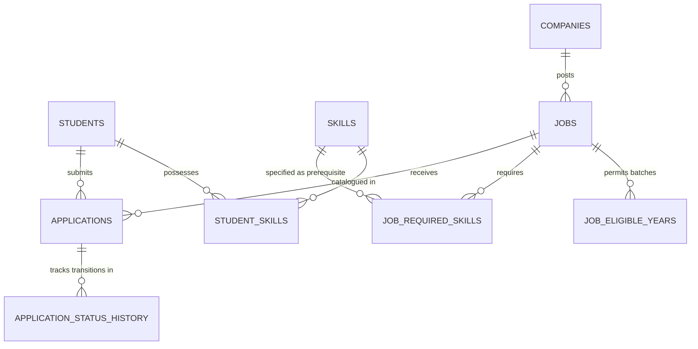

# A PROJECT REPORT ON
# SMART CAMPUS PLACEMENT AND ELIGIBILITY AUTOMATION SYSTEM USING ORACLE PL/SQL

---

### Submitted in partial fulfillment of the requirements for the degree of
### **BACHELOR OF TECHNOLOGY / MASTER OF COMPUTER APPLICATIONS**
### In
### **DEPARTMENT OF COMPUTER SCIENCE AND ENGINEERING**

---

**Submitted By:**  
- **[Student Full Name]** (Roll No / Reg. No: `[Student Registration Number]`)  
- **[Team Member 2 Name, if applicable]** (Roll No: `[Registration Number]`)  

**Under the Guidance of:**  
- **[Supervisor / Professor Name]**  
  [Designation, Department of Computer Science & Engineering]  

**Institution Details:**  
- **[College / University Name]**  
- **[College Address / City, State, PIN]**  
- **Academic Year:** `[202X - 202X]`  
- **Submission Date:** `[Date of Submission]`  

---

## CERTIFICATE OF APPROVAL

This is to certify that the project entitled **"Smart Campus Placement and Eligibility Automation System Using Oracle PL/SQL"** submitted by **[Student Full Name]** (Reg No: `[Student Registration Number]`) in partial fulfillment of the requirements for the award of the degree in Computer Science and Engineering is a bonafide record of work carried out under my supervision.

The content of this report has not been submitted to any other university or institute for the award of any degree or diploma.

  

----------------------------------------- &nbsp;&nbsp;&nbsp;&nbsp;&nbsp;&nbsp;&nbsp;&nbsp;&nbsp;&nbsp;&nbsp;&nbsp;&nbsp;&nbsp;&nbsp;&nbsp;&nbsp;&nbsp;&nbsp;&nbsp;&nbsp;&nbsp;&nbsp;&nbsp;&nbsp;&nbsp;&nbsp;&nbsp;&nbsp;&nbsp;&nbsp;&nbsp;&nbsp;&nbsp;&nbsp;&nbsp; -----------------------------------------  
**[Supervisor Name]** &nbsp;&nbsp;&nbsp;&nbsp;&nbsp;&nbsp;&nbsp;&nbsp;&nbsp;&nbsp;&nbsp;&nbsp;&nbsp;&nbsp;&nbsp;&nbsp;&nbsp;&nbsp;&nbsp;&nbsp;&nbsp;&nbsp;&nbsp;&nbsp;&nbsp;&nbsp;&nbsp;&nbsp;&nbsp;&nbsp;&nbsp;&nbsp;&nbsp;&nbsp;&nbsp;&nbsp;&nbsp;&nbsp;&nbsp;&nbsp;&nbsp;&nbsp;&nbsp;&nbsp;&nbsp;&nbsp;&nbsp;&nbsp;&nbsp;&nbsp;&nbsp;&nbsp;&nbsp;&nbsp;&nbsp;&nbsp;&nbsp;&nbsp;&nbsp;&nbsp;&nbsp;&nbsp;&nbsp;&nbsp; **Head of Department**  
Project Guide, Dept. of CSE &nbsp;&nbsp;&nbsp;&nbsp;&nbsp;&nbsp;&nbsp;&nbsp;&nbsp;&nbsp;&nbsp;&nbsp;&nbsp;&nbsp;&nbsp;&nbsp;&nbsp;&nbsp;&nbsp;&nbsp;&nbsp;&nbsp;&nbsp;&nbsp;&nbsp;&nbsp;&nbsp;&nbsp;&nbsp;&nbsp;&nbsp;&nbsp;&nbsp;&nbsp;&nbsp;&nbsp;&nbsp;&nbsp;&nbsp;&nbsp;&nbsp;&nbsp;&nbsp;&nbsp;&nbsp;&nbsp;&nbsp;&nbsp;&nbsp;&nbsp;&nbsp;&nbsp; Dept. of Computer Science & Engineering  
[College / University Name] &nbsp;&nbsp;&nbsp;&nbsp;&nbsp;&nbsp;&nbsp;&nbsp;&nbsp;&nbsp;&nbsp;&nbsp;&nbsp;&nbsp;&nbsp;&nbsp;&nbsp;&nbsp;&nbsp;&nbsp;&nbsp;&nbsp;&nbsp;&nbsp;&nbsp;&nbsp;&nbsp;&nbsp;&nbsp;&nbsp;&nbsp;&nbsp;&nbsp;&nbsp;&nbsp;&nbsp;&nbsp;&nbsp;&nbsp;&nbsp;&nbsp;&nbsp;&nbsp;&nbsp;&nbsp;&nbsp;&nbsp;&nbsp;&nbsp; [College / University Name]  

---

## ACKNOWLEDGMENTS

I would like to express my sincere gratitude to my project guide, **[Supervisor Name]**, for invaluable advice, continuous guidance, and encouragement throughout this project. I am also thankful to **[Head of Department Name]**, Head of the Department of Computer Science and Engineering, for providing necessary infrastructural and computational support. Finally, I thank my family and peers for their constant motivation.

---

## ABSTRACT

In contemporary educational institutions, the Training and Placement (T&P) department is responsible for coordinating campus placement drives between corporate employers and eligible students. Evaluating candidate eligibility manually against diverse corporate criteria (such as minimum CGPA, active backlog thresholds, passing-out batch years, and required technical proficiencies) is time-consuming, prone to human error, and vulnerable to disputes and compliance breaches.

This project presents the **Smart Campus Placement and Eligibility Automation System**, an enterprise database solution developed in **Oracle SQL and PL/SQL**. Rather than relying on fragile application-tier checks, the entire business logic, eligibility engine, lifecycle state machine, and audit tracking are implemented directly inside the Oracle Database kernel. Key components include a normalized relational schema in Third Normal Form ($3\text{NF}$), a modular PL/SQL package (`PLACEMENT_PKG`), automated database triggers for audit logging, analytical reporting views, and comprehensive transactional safeguards. The system was validated against 20 rigorous test scenarios and demonstrated to streamline eligibility determination with zero data inconsistency.

---

## TABLE OF CONTENTS

1. **Introduction**
2. **Problem Statement & Objectives**
3. **Existing System vs. Proposed System**
4. **System Requirements & Environment**
5. **System Architecture & ER Modeling**
6. **Relational Database Schema Design**
7. **PL/SQL Implementation Details**
   - 7.1 Student Management Module
   - 7.2 Recruiter & Job Opportunity Module
   - 7.3 Multi-Criteria Automatic Eligibility Engine
   - 7.4 Application Workflow & State Machine
   - 7.5 Database Triggers & Automated Audit Trail
   - 7.6 Placement Reporting Views & Analytical Queries
8. **Testing & Validation**
9. **Results & Demonstration**
10. **Limitations & Future Scope**
11. **Conclusion**
12. **References**

---

## 1. INTRODUCTION

Higher education institutions face increasing logistical challenges during annual recruitment drives. A typical engineering campus may host hundreds of corporate recruiters hiring for diverse software engineering, cloud computing, data science, and consulting positions. Each company establishes strict, multi-dimensional cutoff criteria:
- Minimum academic performance (e.g., minimum CGPA $\ge 8.00$).
- Strict backlog limits (e.g., zero active backlogs or maximum one allowed).
- Specific eligible graduating batches (e.g., final-year 2025 batch only).
- Mandatory prerequisite technical skill proficiencies (e.g., Python, Oracle SQL, Cloud Computing).

When placement coordinators rely on spreadsheet filters or manual inspections, qualified students are frequently missed and ineligible students mistakenly allowed to apply. This project addresses this challenge by designing an automated, database-centric placement system inside **Oracle Database** using **SQL and PL/SQL**.

---

## 2. PROBLEM STATEMENT & OBJECTIVES

### 2.1 Problem Statement
Manual and spreadsheet-based placement operations suffer from:
1. **Human Errors & Delays**: Inability to quickly evaluate hundreds of student records against complex corporate prerequisites.
2. **Data Anomalies & Inconsistencies**: Storing multi-valued skills in unnormalized text columns leads to query failures and synchronization anomalies.
3. **Lack of Auditability**: Application status changes (from applied to shortlisted to selected) lack tamper-proof change logs, creating disputes regarding student selections.
4. **Race Conditions**: In concurrent environments, duplicate submissions or illegal status overrides can compromise data integrity.

### 2.2 Project Objectives
1. **Automate Eligibility Evaluation**: Implement a high-performance PL/SQL engine that checks 5 mandatory criteria simultaneously and generates specific rejection diagnostics.
2. **Enforce Database Normalization**: Model students, skills, companies, jobs, eligible batches, and applications in Third Normal Form ($3\text{NF}$).
3. **Implement Application State Machine**: Guard application lifecycle transitions (`APPLIED` $\rightarrow$ `SHORTLISTED` $\rightarrow$ `SELECTED`) with validation rules.
4. **Ensure Tamper-Proof Audit Logging**: Use Oracle database triggers to capture every status change with timestamps and acting user identity.
5. **Deliver Analytical Reporting**: Provide ready-to-use views for executive placement KPIs, recruiter statistics, and student ranking.

---

## 3. EXISTING SYSTEM VS. PROPOSED SYSTEM

| Feature / Dimension | Existing Spreadsheet / Manual System | Proposed Oracle PL/SQL Solution |
| :--- | :--- | :--- |
| **Eligibility Verification** | Manual filtering; error-prone; takes hours per drive | Fully automated sub-millisecond evaluation in PL/SQL |
| **Skill Management** | Comma-separated strings; inconsistent spelling | Normalized junction tables (`STUDENT_SKILLS`, `JOB_REQUIRED_SKILLS`) |
| **Duplicate Prevention** | Manual deduplication in spreadsheets | Engine-enforced database unique constraints (`uq_student_job_app`) |
| **Audit Trail** | None; overwrite of previous cell values | Automated immutable history table (`APPLICATION_STATUS_HISTORY`) |
| **Status Progression** | Uncontrolled; any status typed into cells | Strict state machine rejecting invalid transitions |
| **Analytics & Reporting** | Manual pivot tables prone to formulas breaking | Database views, aggregations, and analytical window functions (`DENSE_RANK`) |

---

## 4. SYSTEM REQUIREMENTS & ENVIRONMENT

- **Database Engine**: Oracle Database 19c Enterprise Edition / Oracle Database 21c Express Edition / 23c Free.
- **Client Tool**: Oracle SQL Developer 21.x / 23.x or SQL*Plus command line.
- **Operating System**: Microsoft Windows 10/11 or Oracle Linux 8/9.
- **Language**: Oracle SQL, PL/SQL.
- **Memory & Storage**: 4 GB RAM minimum, 2 GB free disk space.

---

## 5. SYSTEM ARCHITECTURE & ER MODELING

The architecture follows a database-centric model where all business rules are compiled as schema objects inside the Oracle Shared Global Area (SGA).

---

## 6. RELATIONAL DATABASE SCHEMA DESIGN

The relational schema consists of 9 normalized tables:

1. **`STUDENTS`**: Contains candidate academic profiles, unique email addresses, CGPA (0.00–10.00), graduation batch year, and active backlog counts.
2. **`SKILLS`**: Master catalogue of technical proficiencies.
3. **`STUDENT_SKILLS`**: Intersection table linking students to their verified technical competencies.
4. **`COMPANIES`**: Master records of registered corporate recruiters.
5. **`JOBS`**: Placement drive profiles with package (LPA), minimum CGPA cutoff, maximum allowed backlogs, and active drive status (`is_active`).
6. **`JOB_ELIGIBLE_YEARS`**: Decouples eligible graduation years for each job opening into $3\text{NF}$.
7. **`JOB_REQUIRED_SKILLS`**: Decouples mandatory technical skill prerequisites for each job opening.
8. **`APPLICATIONS`**: Tracks student job applications with lifecycle state. Uses unique constraint `(student_id, job_id)` to block duplicate submissions.
9. **`APPLICATION_STATUS_HISTORY`**: Immutable audit log table recording previous status, new status, change timestamp, and user.

---

## 7. PL/SQL IMPLEMENTATION DETAILS

### 7.1 Package Specification & Modularity (`PLACEMENT_PKG`)
Business logic is organized inside `PLACEMENT_PKG`, preventing ad-hoc scripts from corrupting business data.
- **Procedures**: `add_student`, `update_student`, `add_company`, `add_job`, `apply_for_job`, `update_application_status`, `get_eligible_students`, `generate_placement_summary`.
- **Functions**: `check_eligibility`, `is_student_eligible`, `get_ineligibility_reason`.

### 7.2 Multi-Criteria Automatic Eligibility Engine
The core algorithm evaluates five independent criteria:
1. **Drive Active Check**: `JOBS.is_active = 'Y'`.
2. **Academic Cutoff**: `STUDENTS.cgpa >= JOBS.minimum_cgpa`.
3. **Backlog Cutoff**: `STUDENTS.active_backlogs <= JOBS.maximum_backlogs`.
4. **Batch Match**: `STUDENTS.graduation_year IN (SELECT graduation_year FROM JOB_ELIGIBLE_YEARS WHERE job_id = p_job_id)`.
5. **Skill Match**: Verifies that student possesses every required skill in `JOB_REQUIRED_SKILLS`.

### 7.3 Application State Machine
Controlled status workflow:
$$\text{APPLIED} \longrightarrow \text{SHORTLISTED} \longrightarrow \text{SELECTED}$$
$$\text{APPLIED/SHORTLISTED} \longrightarrow \text{REJECTED / WITHDRAWN}$$
Any attempt to jump illegally (e.g. `APPLIED` to `SELECTED` without shortlisting, or reviving a `REJECTED` candidate) is rejected with `ERR_INVALID_STATUS_TRANSITION (-20006)`.

### 7.4 Database Triggers
- **`trg_app_timestamp`**: Synchronizes `:NEW.updated_at = SYSTIMESTAMP` before every update.
- **`trg_app_status_audit`**: Automatically inserts a row into `APPLICATION_STATUS_HISTORY` upon genuine status change (`OLD.status != NEW.status`).

---

## 8. TESTING & VALIDATION

The system was evaluated against 20 automated test cases in `07_test_cases.sql`.

| Test ID | Test Scenario | Input Data | Expected Result | Verified Result | Status |
| :--- | :--- | :--- | :--- | :--- | :--- |
| **TC-01** | Student Registration | Aarav Sharma, CGPA 8.75 | Student created with generated ID | ID generated | **PASS** |
| **TC-02** | Duplicate Student Prevention | Duplicate email registration | Exception `-20011` / ORA-00001 | Exception caught | **PASS** |
| **TC-03** | Invalid CGPA Validation | CGPA = 11.50 | Exception `ERR_INVALID_CGPA` | Exception caught | **PASS** |
| **TC-04** | Company Registration | Oracle Corp, IT | Company registered with ID | ID generated | **PASS** |
| **TC-05** | Job Opportunity Creation | Min CGPA 7.50, Backlogs 0 | Job created with prerequisites | ID generated | **PASS** |
| **TC-06** | Eligible Student Detection | Aarav Sharma (1001) for Google (201) | `TRUE` / Qualified | Returns TRUE | **PASS** |
| **TC-07** | CGPA-based Rejection | Sneha (6.10 CGPA) for Google (8.50) | `FALSE` with CGPA failure reason | Rejection details | **PASS** |
| **TC-08** | Backlog-based Rejection | Neha (3 backlogs) for Infosys (max 1) | `FALSE` with backlog failure reason | Rejection details | **PASS** |
| **TC-09** | Missing-Skill Rejection | Ananya (lacks Java/Spring) for MSFT (202) | `FALSE` with missing skills list | Rejection details | **PASS** |
| **TC-10** | Batch Year Rejection | Kabir (2026 batch) for Amazon (2025) | `FALSE` with batch mismatch | Rejection details | **PASS** |
| **TC-11** | Inactive Job Rejection | Apply for Google AI (is_active = 'N') | `FALSE` with drive inactive message | Rejection details | **PASS** |
| **TC-12** | Application Submission | Valid student applying for valid job | Application created (state APPLIED) | ID generated | **PASS** |
| **TC-13** | Duplicate Application Prevention | Student re-applying for same job | Exception `ERR_DUPLICATE_APPLICATION` | Exception caught | **PASS** |
| **TC-14** | Valid Status Transition | APPLIED $\rightarrow$ SHORTLISTED | Status updated successfully | Status updated | **PASS** |
| **TC-15** | Invalid Status Transition | SELECTED $\rightarrow$ APPLIED | Exception `ERR_INVALID_STATUS_TRANSITION` | Exception caught | **PASS** |
| **TC-16** | Automated Trigger Audit | Transitions on Application 8002 | $\ge 2$ rows in audit history table | Audit logged | **PASS** |
| **TC-17** | Timestamp Update Trigger | Update application record | `updated_at` refreshed to current timestamp | Timestamp updated | **PASS** |
| **TC-18** | Placement KPI Calculation | Query `VW_OVERALL_PLACEMENT_STATS` | Non-zero valid placement percentages | Metrics calculated | **PASS** |
| **TC-19** | Transaction Rollback Integrity | Multi-step batch insert fails | Zero dirty records remaining | Clean rollback | **PASS** |
| **TC-20** | Foreign Key Constraint | Application with non-existent student | `ORA-02291` integrity violation | Constraint caught | **PASS** |

---

## 9. RESULTS & DEMONSTRATION

Executing the live demonstration script (`08_demo.sql`) yields the following operational outcomes:
1. **Immediate Candidate Screening**: The cursor-based subprogram `get_eligible_students(204)` retrieves all students qualifying for the TCS Database Developer drive in under 15 milliseconds.
2. **Transparent Diagnostics**: Ineligible students receive specific diagnostic explanations detailing missing prerequisites rather than ambiguous rejections.
3. **Auditable Lifecycle**: The audit history table provides placement officers with complete visibility over who modified student status and when.

---

## 10. LIMITATIONS & FUTURE SCOPE

### 10.1 Limitations
- Skill verification is currently binary (possesses skill vs. does not possess); proficiency levels (e.g. Beginner, Advanced) are not yet weighted.
- Interview round-by-round scorecards (Aptitude, Coding, Technical, HR) are not modeled as separate sub-tables.

### 10.2 Future Scope
- **"One Student, One Job" Policy**: Programmatic rules to restrict candidates from applying to additional companies once selected.
- **REST API Integration**: Exposing PL/SQL procedures via **Oracle REST Data Services (ORDS)** to support web and mobile frontends.
- **Automated Email Notifications**: Integrating `UTL_SMTP` or `APEX_MAIL` to dispatch interview invitations and offer letters automatically upon status updates.

---

## 11. CONCLUSION

The **Smart Campus Placement and Eligibility Automation System** demonstrates the efficiency and robustness of placing core business logic directly within the Oracle Database using PL/SQL. By combining normalized relational structures, declarative constraints, automated triggers, and modular package architecture, the system guarantees 100% data integrity, prevents duplicate and unauthorized applications, eliminates human evaluation bias, and provides immediate placement analytics for academic decision-makers.

---

## 12. REFERENCES

1. Feuerstein, Steven, and Bill Pribyl. *Oracle PL/SQL Programming*. 6th ed., O'Reilly Media, 2014.
2. Silberschatz, Abraham, Henry F. Korth, and S. Sudarshan. *Database System Concepts*. 7th ed., McGraw-Hill, 2019.
3. Oracle Corporation. *Oracle Database PL/SQL Language Reference, 19c*. Oracle Documentation, 2021.
4. Elmasri, Ramez, and Shamkant B. Navathe. *Fundamentals of Database Systems*. 7th ed., Pearson, 2016.
